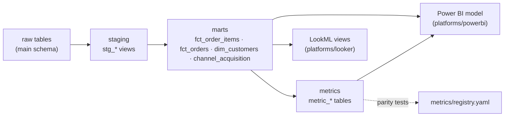

# dbt Layer (working)

A working dbt project that builds the registry's metrics as tested
warehouse tables, on the same synthetic DuckDB warehouse everything else
reads. It runs locally in seconds, with no services and no credentials.

The project is warehouse-agnostic: the same models, tests, and macros
also build on Snowflake, Databricks, and Redshift, selected with
`--target`. DuckDB stays the default and the only target CI runs; the
cloud targets are opt-in and use your own credentials. See
[Run on a cloud warehouse](#run-on-a-cloud-warehouse).

dbt is the transformation layer that sits *underneath* the registry, not
beside it: `base_fact_sql` becomes a real `fct_order_items` table built
once, cohort logic ("first order", "last order", 90-day revenue) lives in
one shared `dim_customers` table, and each registry metric gets a dbt
model. `metrics/registry.yaml` stays the definition of record, and parity
tests fail CI if any dbt model ever disagrees with it.

## Layers



| Layer | Models | Purpose |
|---|---|---|
| `staging/` | `stg_customers`, `stg_orders`, `stg_order_items`, `stg_products`, `stg_marketing_spend` | One view per raw table: typing and renames only, no business logic |
| `marts/` | `fct_order_items` | Order-item grain fact; the dbt implementation of `base_fact_sql`, carrying the filterable dimensions (channel, region, category) |
| | `fct_orders` | Order grain, with order revenue and the order's position in the customer's sequence |
| | `channel_acquisition` | Channel grain: marketing spend and acquired customers, the two additive inputs to CAC |
| | `dim_customers` | Customer grain, including never-purchased customers; the single definition of first order, last order, 90-day revenue, purchase outcome, and churn flag |
| `metrics/` | `metric_<registry_id>` (7 models) | One table per registry metric, output columns identical to `resolve_metric()` |

Everything builds into an `analytics` schema in `data/warehouse.duckdb`,
kept separate from the raw tables in `main`.

## Run it

From the repo root, after the core setup in the main README:

```bash
pip install -r platforms/dbt/requirements.txt
python data/generate_synthetic_data.py      # if the warehouse doesn't exist yet
dbt build --project-dir platforms/dbt --profiles-dir platforms/dbt
pytest tests/ -v                            # now includes dbt parity tests
```

`dbt build` runs all 16 models and 44 data tests in about two seconds.

## How it stays governed

**dbt's own tests** (run by `dbt build`):

- `unique` / `not_null` on every primary key; `relationships` from orders
  to customers and from line items to orders and products;
  `accepted_values` on channels, regions, and funnel outcomes.
- A dependency-free `unique_combination` generic test
  (`tests/generic/unique_combination.sql`) for multi-column grains, so the
  project needs nothing beyond dbt-core and one adapter.
- `assert_fact_revenue_reconciles_to_source`: `fct_order_items` must
  neither drop nor duplicate revenue on its joins.
- `assert_funnel_partitions_all_customers`: every customer lands in exactly
  one funnel outcome.

**Registry parity** (`tests/test_dbt_parity.py`, run by pytest):

1. **Coverage.** Every registry metric has a dbt model, linked by
   `meta.registry_id` in `models/metrics/_metrics.yml`, and every dbt metric
   model points at a real registry metric.
2. **Fact parity.** `fct_order_items` is row-for-row identical to the
   registry's `base_fact_sql`, so filtered metrics and LookML measures
   slice exactly the rows the resolver does.
3. **Metric parity.** Each `metric_*` table equals `resolve_metric()`
   output, column names included.

A wrong-but-plausible change, such as computing AOV at line-item grain
instead of order grain, passes every dbt test and fails
`test_dbt_metric_matches_registry[aov]`. That's the point: dbt tests check
that the data is well-formed, and the parity tests check that it still
means what the registry says it means.

Locally, the parity value checks skip if `dbt build` hasn't run yet. CI
sets `REQUIRE_DBT=1`, which turns that skip into a failure.

## Run on a cloud warehouse

Nothing in `models/`, `tests/`, or `macros/` changes between warehouses.
What differs is confined to three places:

| What | Where | DuckDB | Cloud targets |
|---|---|---|---|
| Connection | `profiles.yml` output | local file | credentials from env vars |
| Raw schema | `models/staging/_sources.yml` | `main` | `raw` (override: `BI_FRAMEWORK_RAW_SCHEMA`) |
| Dialect differences | `macros/` | see below | see below |

The dialect differences the models used to depend on, and what replaced them:

- **Date arithmetic.** `date + interval 90 day` is DuckDB syntax. The
  90-day LTV and churn windows now go through `days_from()`
  (`macros/days_from.sql`), a thin wrapper over dbt's cross-database
  `dbt.dateadd`.
- **Float width.** `float` is 64-bit on Snowflake and Redshift but 32-bit
  on DuckDB and Databricks, so `dbt.type_float()` would silently change
  revenue. Staging casts money columns with `type_double()`
  (`macros/type_double.sql`), an adapter-dispatched macro that always
  yields a 64-bit type.
- **Booleans.** `is_churned_90d` was a bare comparison used as a column
  value; it is now an explicit `case ... then true else false end` with a
  typed null.
- **Implicit typing.** Staging casts ids to `dbt.type_bigint()` and dates
  to `date` instead of relying on what the loader inferred.
- **Comma joins / `!=`** in the singular tests became `cross join` / `<>`.

There was no `QUALIFY`, `::` casting, `date_diff`, or DuckDB-only string
function to remove; `tests/test_warehouse_portability.py` keeps it that way.

### 1. Get a warehouse

Any one of these is enough. The first two are free:

- **Snowflake**: a [30-day free trial](https://signup.snowflake.com/)
  with usage credits, no card required. Create a database for the demo
  (`CREATE DATABASE BI_FRAMEWORK;`); the trial's default `COMPUTE_WH`
  warehouse is fine.
- **Databricks**: [Free Edition](https://www.databricks.com/learn/free-edition),
  which includes a serverless SQL warehouse and Unity Catalog. The default
  catalog is `workspace`. Copy the warehouse's HTTP path from its
  *Connection details* tab and create a personal access token under
  *Settings → Developer*.
- **Redshift**: no standing free tier; new AWS accounts get a Redshift
  Serverless trial credit. Any provisioned cluster or serverless workgroup
  reachable from your machine works.

### 2. Set credentials

Every credential is read from an environment variable; nothing secret is
stored in the repo. Copy the template, fill in the block for your
warehouse, and load it into your shell:

```bash
cp .env.example .env          # .env is gitignored
set -a; source .env; set +a
```

| Target | Required | Optional |
|---|---|---|
| `snowflake` | `SNOWFLAKE_ACCOUNT`, `SNOWFLAKE_USER`, `SNOWFLAKE_ROLE`, `SNOWFLAKE_WAREHOUSE`, `SNOWFLAKE_DATABASE`, and `SNOWFLAKE_PASSWORD` (password or programmatic access token) | `SNOWFLAKE_PRIVATE_KEY_PATH` (+ `SNOWFLAKE_PRIVATE_KEY_PASSPHRASE`) for key-pair auth instead of a password |
| `databricks` | `DATABRICKS_HOST`, `DATABRICKS_HTTP_PATH`, `DATABRICKS_TOKEN` | `DATABRICKS_CATALOG` (default `workspace`) |
| `redshift` | `REDSHIFT_HOST`, `REDSHIFT_USER`, `REDSHIFT_PASSWORD`, `REDSHIFT_DATABASE` | `REDSHIFT_PORT` (default `5439`); `REDSHIFT_S3_BUCKET` + `REDSHIFT_IAM_ROLE` to load with `COPY` from S3 |

### 3. Install the adapter

Each warehouse has its own optional requirements file, so the default
install stays small:

```bash
pip install -r platforms/dbt/requirements-snowflake.txt     # or -databricks / -redshift
```

### 4. Load the synthetic data

dbt transforms data that's already in the warehouse, so the raw tables
have to get there first:

```bash
python data/generate_synthetic_data.py                        # writes data/synthetic/*.csv
python scripts/load_synthetic_to_warehouse.py --target snowflake
```

The script exports the CSVs to typed Parquet and bulk-loads the five raw
tables into a `raw` schema: `PUT` + `COPY INTO` on Snowflake, `PUT` to a
Unity Catalog volume + `read_files()` on Databricks, and batched `INSERT`s
on Redshift (or `COPY` from S3 if you set the bucket and IAM role). It
then checks each table's row count. Add `--dry-run` to print the SQL
without connecting to anything.

### 5. Build and test

```bash
dbt build --project-dir platforms/dbt --profiles-dir platforms/dbt --target snowflake
```

Same models, same 44 data tests, in the warehouse's `analytics` schema.

### 6. Run the parity tests against it

```bash
DBT_PARITY_TARGET=snowflake pytest tests/test_dbt_parity.py -v
```

This turns on the `test_cloud_*` tests, which read `fct_order_items` and
every `metric_*` table from the cloud warehouse and compare them to the
registry. The registry's formula SQL is DuckDB dialect, so it is never
sent to the cloud warehouse: the expected values are
`resolve_metric()`'s results on your local DuckDB warehouse. Both sides
are built from the same seeded synthetic data, so they must agree (to
within `1e-6`, to allow for float summation order). Regenerate the data
and you must reload it, or the comparison will rightly fail.

Without `DBT_PARITY_TARGET` those tests skip. If it is set but the
credentials or the dbt tables are missing, they fail rather than skip.

### What has and hasn't been verified

| Target | In CI | How it was checked |
|---|---|---|
| DuckDB | yes, every PR | `dbt build` + all parity tests |
| Snowflake, Redshift | no | `dbt compile` against the real adapter, offline, and the compiled SQL parsed in the target dialect. Not executed against a live warehouse as part of this repo's automation. |
| Databricks | no | Same, except its `dateadd` macro needs a live connection to compile, so that one expression was checked with the macro's documented output substituted. |

CI is deliberately credential-free, so it can't prove a cloud run works;
it proves the DuckDB build is correct and holds the portability plumbing
in place (`tests/test_warehouse_portability.py`: no secrets in
`profiles.yml`, no DuckDB-only SQL in the models, and the load script's
export-and-load path reproduces the raw tables against a second DuckDB
file). A cloud target is verified when you run steps 4–6 against it.

## Semantic layers on top

`meta.semantic` in `models/marts/_marts.yml` and
`models/metrics/_metrics.yml` restates each metric as one aggregate over a
mart. `scripts/export_semantic_layer.py` combines that with the registry
to generate a Snowflake semantic view and Databricks Unity Catalog metric
views, and `tests/test_semantic_layer_export.py` runs each expression on
DuckDB against the registry. See
[`platforms/semantic_layer`](../semantic_layer/README.md).

## What's next

dbt's Semantic Layer (MetricFlow) could replace the `metric_*` tables with
`semantic_models` and `metrics` YAML on top of `fct_order_items`, so BI
tools query metrics through dbt directly. It's left out here to keep the
project runnable with nothing but dbt-core and dbt-duckdb; the parity
tests would carry over unchanged.
