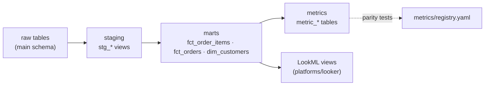

# dbt Layer (working)

A working dbt project that builds the registry's metrics as tested
warehouse tables, on the same synthetic DuckDB warehouse everything else
reads. It runs locally in seconds, with no services and no credentials.

dbt is the transformation layer that sits *underneath* the registry, not
beside it: `base_fact_sql` becomes a real `fct_order_items` table built
once, cohort logic ("first order", "last order", 90-day revenue) lives in
one shared `dim_customers` table, and each registry metric gets a dbt
model. `metrics/registry.yaml` stays the definition of record, and parity
tests fail CI if any dbt model ever disagrees with it.

## Layers



| Layer | Models | Purpose |
|---|---|---|
| `staging/` | `stg_customers`, `stg_orders`, `stg_order_items`, `stg_products`, `stg_marketing_spend` | One view per raw table: typing and renames only, no business logic |
| `marts/` | `fct_order_items` | Order-item grain fact; the dbt implementation of `base_fact_sql`, carrying the filterable dimensions (channel, region, category) |
| | `fct_orders` | Order grain, with order revenue and the order's position in the customer's sequence |
| | `dim_customers` | Customer grain, including never-purchased customers; the single definition of first order, last order, 90-day revenue, purchase outcome, and churn flag |
| `metrics/` | `metric_<registry_id>` (7 models) | One table per registry metric, output columns identical to `resolve_metric()` |

Everything builds into an `analytics` schema in `data/warehouse.duckdb`,
kept separate from the raw tables in `main`.

## Run it

From the repo root, after the core setup in the main README:

```bash
pip install -r platforms/dbt/requirements.txt
python data/generate_synthetic_data.py      # if the warehouse doesn't exist yet
dbt build --project-dir platforms/dbt --profiles-dir platforms/dbt
pytest tests/ -v                            # now includes dbt parity tests
```

`dbt build` runs all 15 models and 41 data tests in about two seconds.

## How it stays governed

**dbt's own tests** (run by `dbt build`):

- `unique` / `not_null` on every primary key; `relationships` from orders
  to customers and from line items to orders and products;
  `accepted_values` on channels, regions, and funnel outcomes.
- A dependency-free `unique_combination` generic test
  (`tests/generic/unique_combination.sql`) for multi-column grains, so the
  project needs nothing beyond dbt-core and dbt-duckdb.
- `assert_fact_revenue_reconciles_to_source`: `fct_order_items` must
  neither drop nor duplicate revenue on its joins.
- `assert_funnel_partitions_all_customers`: every customer lands in exactly
  one funnel outcome.

**Registry parity** (`tests/test_dbt_parity.py`, run by pytest):

1. **Coverage.** Every registry metric has a dbt model, linked by
   `meta.registry_id` in `models/metrics/_metrics.yml`, and every dbt metric
   model points at a real registry metric.
2. **Fact parity.** `fct_order_items` is row-for-row identical to the
   registry's `base_fact_sql`, so filtered metrics and LookML measures
   slice exactly the rows the resolver does.
3. **Metric parity.** Each `metric_*` table equals `resolve_metric()`
   output, column names included.

A wrong-but-plausible change, such as computing AOV at line-item grain
instead of order grain, passes every dbt test and fails
`test_dbt_metric_matches_registry[aov]`. That's the point: dbt tests check
that the data is well-formed, and the parity tests check that it still
means what the registry says it means.

Locally, the parity value checks skip if `dbt build` hasn't run yet. CI
sets `REQUIRE_DBT=1`, which turns that skip into a failure.

## What's next

dbt's Semantic Layer (MetricFlow) could replace the `metric_*` tables with
`semantic_models` and `metrics` YAML on top of `fct_order_items`, so BI
tools query metrics through dbt directly. It's left out here to keep the
project runnable with nothing but dbt-core and dbt-duckdb; the parity
tests would carry over unchanged.
