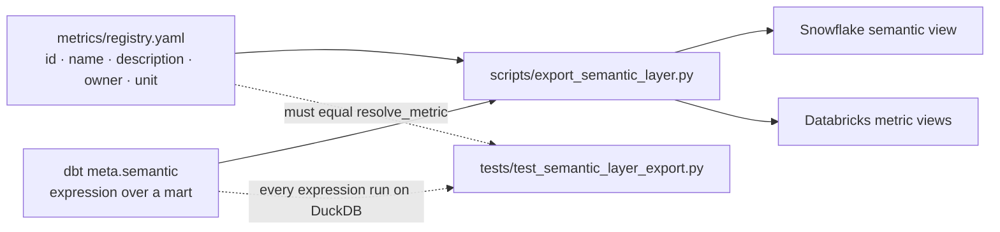

# Warehouse-native semantic layers (generated)

Snowflake and Databricks each have a semantic layer built into the
warehouse: Snowflake **semantic views** and Databricks **Unity Catalog
metric views**. The files here define the registry's metrics in both, so
BI tools and AI agents querying the warehouse directly get the same
governed definitions as everything else in this repo.

They are generated, not hand-written:

```bash
python scripts/export_semantic_layer.py           # regenerate
python scripts/export_semantic_layer.py --check   # fail if stale
python scripts/export_semantic_layer.py --catalog main   # non-default Databricks catalog
```

| File | What it is |
|---|---|
| `snowflake/bi_framework_metrics.semantic_view.sql` | One `CREATE SEMANTIC VIEW` covering all seven registry metrics |
| `databricks/<view>.metric_view.yaml` | One metric view YAML per dbt mart |
| `databricks/create_metric_views.sql` | `CREATE VIEW ... WITH METRICS LANGUAGE YAML` for each, with the YAML embedded |

A Databricks metric view has a single source table, so the seven metrics
are split across three views by the mart they aggregate
(`order_items_metrics`, `customers_metrics`, `channel_acquisition_metrics`).
A Snowflake semantic view holds several logical tables, so one view covers
them all.

## Where the definitions come from



- **`metrics/registry.yaml`** decides which metrics exist and supplies each
  one's id, name, description, owner, and unit. Every exported metric is
  named after its registry id and carries `[registry:<id>; owner; unit]`
  in its comment.
- **`meta.semantic` in the dbt project** says how each metric is written as
  a single aggregate over a dbt mart
  (`platforms/dbt/models/metrics/_metrics.yml`), and which columns of each
  mart are its key and dimensions
  (`platforms/dbt/models/marts/_marts.yml`). The registry's own formulas
  run against raw tables in DuckDB dialect, so they can't be pasted into a
  semantic view; this mapping is the portable restatement, and it sits
  next to the dbt model that implements the same metric.

The export script contains no metric expression of its own, and a registry
metric without a mapping is an error rather than a silent omission.

## How it stays governed

`tests/test_semantic_layer_export.py` runs in CI, without credentials:

1. **Coverage.** Every registry metric appears exactly once in the
   Snowflake view and exactly once across the Databricks views.
2. **Freshness.** The committed files equal what the generator produces
   now. Change the registry and forget to regenerate, and CI fails.
3. **Value parity.** Each exported expression is executed on DuckDB over
   the mart it targets and must equal `resolve_metric()`: unfiltered, and
   for every value of every registry filter the mart exposes as a
   dimension (so `net_revenue` and `aov` sliced by channel, region, or
   category match the registry's parameterized filters).
4. **Lineage.** Both layers read only the dbt-built `analytics` schema.

One limit, by design: `repeat_purchase_rate` is exported at customer
grain. It matches the registry unfiltered and by region, but it can't
follow order-level channel or category filters (a customer with two
orders overall but one on `email` is a one-time buyer when filtered to
`email`). The exported description says so; use the resolver for those.

## Use it

After loading the data and running `dbt build --target <warehouse>` (see
[`platforms/dbt/README.md`](../dbt/README.md#run-on-a-cloud-warehouse)):

```sql
-- Snowflake: run snowflake/bi_framework_metrics.semantic_view.sql, then
SELECT * FROM SEMANTIC_VIEW(
  analytics.bi_framework_metrics
  METRICS order_items.net_revenue, order_items.aov
  DIMENSIONS order_items.channel
);

-- Databricks: run databricks/create_metric_views.sql, then
SELECT channel, MEASURE(net_revenue), MEASURE(aov)
FROM workspace.analytics.order_items_metrics
GROUP BY ALL;
```

The exported metrics keep the registry's rounding, so results line up with
`resolve_metric()` to the cent.

## Status: syntax checked against the docs, not executed

Both features are new and still changing. The generated syntax was checked
against the vendors' current documentation in November 2026, but **neither
file has been run against a live account**, and CI can't do that. What was
confirmed, and what to watch for on first run:

**Snowflake** ([CREATE SEMANTIC VIEW](https://docs.snowflake.com/en/sql-reference/sql/create-semantic-view),
[SQL guide](https://docs.snowflake.com/en/user-guide/views-semantic/sql),
[querying](https://docs.snowflake.com/en/user-guide/views-semantic/querying)):
the clause order (`TABLES`, `RELATIONSHIPS`, `DIMENSIONS`, `METRICS`,
`COMMENT`), logical tables with `PRIMARY KEY`, named relationships with
`REFERENCES`, `<table>.<name> AS <expr>` entries with `COMMENT = '...'`,
metrics that combine aggregates in one expression, and the
`SEMANTIC_VIEW(... METRICS ... DIMENSIONS ...)` query clause.
Not specifically confirmed: `COUNT(DISTINCT ...)` inside a metric
expression (used by `aov`).

**Databricks** ([YAML reference](https://docs.databricks.com/aws/en/uc-semantics/metric-views/yaml-reference),
[create a metric view](https://docs.databricks.com/aws/en/uc-semantics/metric-views/create),
[CREATE VIEW](https://docs.databricks.com/aws/en/sql/language-manual/sql-ref-syntax-ddl-create-view)):
the `version`, `comment`, `source`, `dimensions`, and `measures` keys,
`name` / `expr` / `comment` entries, measures that are ratios of
aggregates or use `COUNT(DISTINCT ...)`, the
`WITH METRICS LANGUAGE YAML AS $$ ... $$` wrapper, and `MEASURE()` queries.
`version: 1.1` (needed for `comment`) requires Databricks Runtime 17.2 or
above. The current reference calls dimensions `fields` and accepts
`dimensions` as the equivalent older keyword; this export uses
`dimensions` because it is accepted by both. Not confirmed: whether
metric views are enabled on Free Edition.
